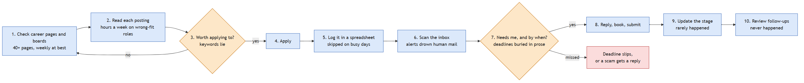
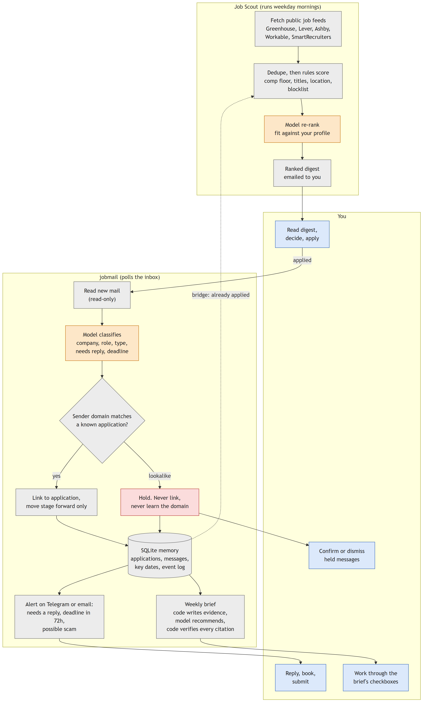
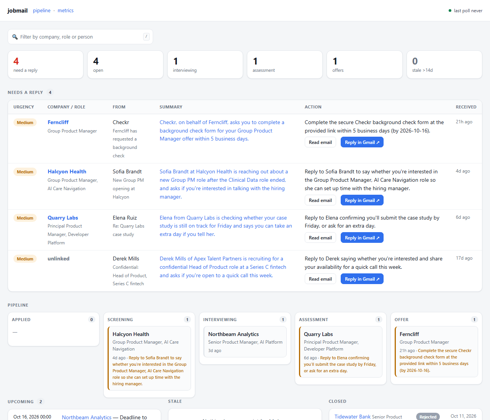
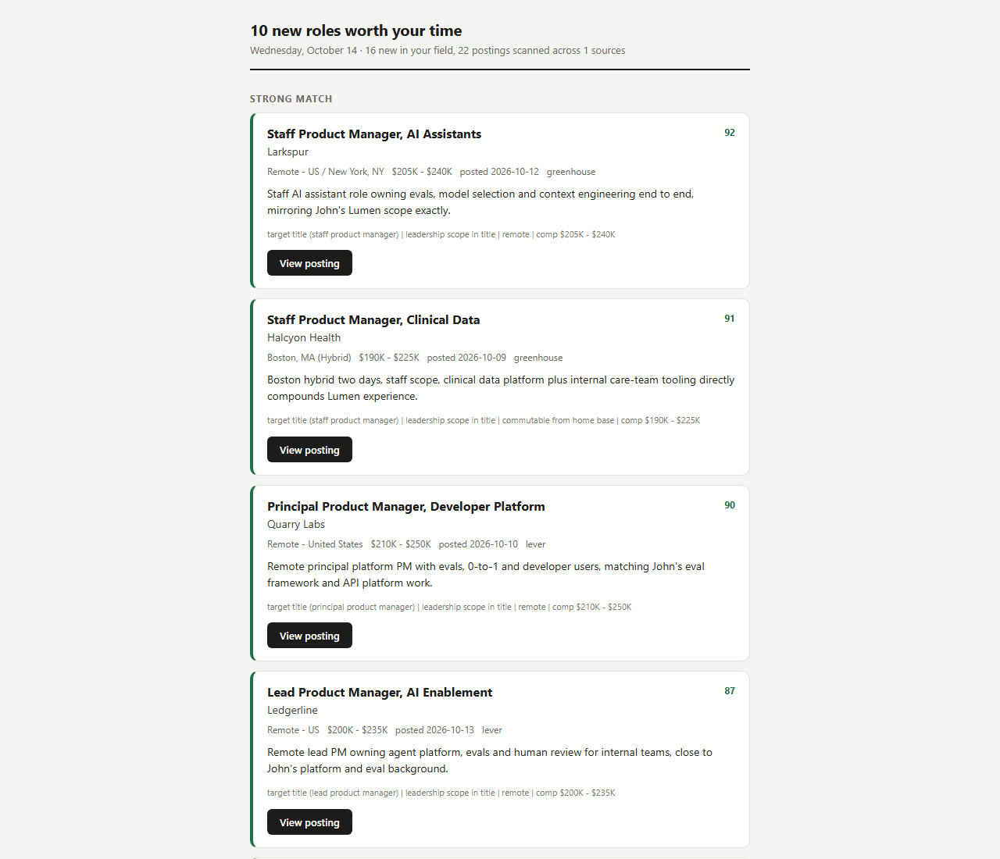
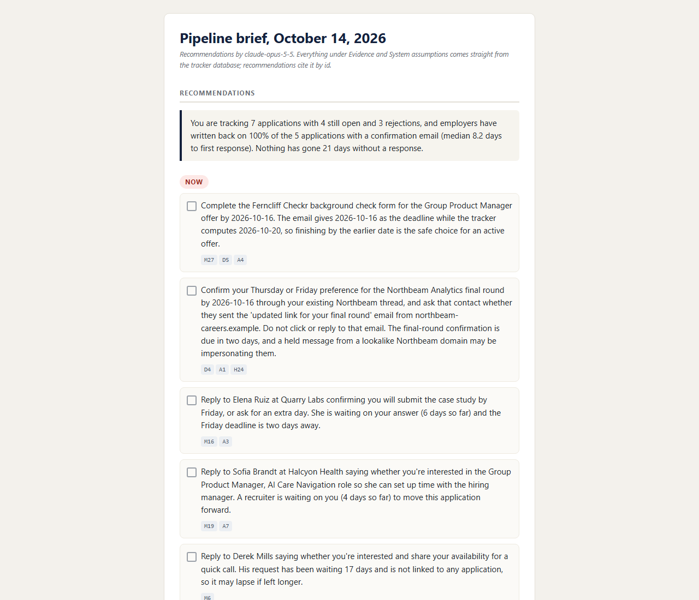
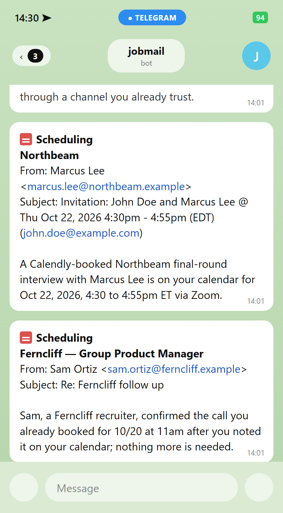

# Job Scout + jobmail

[](https://github.com/Bellistri-Nick/job-scout/actions/workflows/tests.yml)

**Two agents that find the jobs that meet your criteria and make sure nothing falls through the cracks after you apply.**

- Job Scout reads public job feeds and ranks postings against your background.
- jobmail reads your job-search inbox, links mail to applications, tracks stages, and holds anything that looks like a scam.
- A read-only bridge lets each one use the other's memory. Scout stops surfacing roles you already applied to.

> **Reviewing this?** Run `python demo.py` (offline, two minutes), then read [CASE_STUDY.md](CASE_STUDY.md). The table under [What the brief asks for](#what-the-brief-asks-for-and-where-it-is) maps every requirement to a file.

## The problem

Looking for a job is a second job. You set up alerts on four boards, and every morning they hand you forty roles that match a keyword and nothing else. "Senior Product Designer" shows up whether the role owns a product end to end or resizes banner ads for an agency. Your salary floor isn't in the filter. Neither is "nothing more than two days in an office." So you read all forty, apply to three, and lose an evening.

Then the applications pile up. Fifty of them in parallel, each with its own thread. The spreadsheet you started in week one is stale by week three. A recruiter writes "can you send times by Thursday?" and it lands between two alert digests and a shipping notice. You see it Friday. And a company that went quiet looks exactly like one that replied yesterday, because nothing is tracking either.

Two things, then. Find the roles that fit what you actually need, and once you've applied, don't let anything slip. Job Scout does the first. jobmail does the second.

Here's the thing about both: the hard step is judgment over free text, and judgment fails quietly. A missed deadline raises no error. A wrong comp floor just buries good roles. So each agent puts a model on exactly one judgment call, ranking a posting or reading an email, and everything around it (fetching, deduping, linking, stage tracking, alerting) is plain code that tests can pin down. The current workflow, mapped step by step, is in [CASE_STUDY.md](CASE_STUDY.md#current-workflow-mapped).

## Process map

Today, a search is ten manual steps. Two need judgment (3 and 7). The bookkeeping around them gets skipped on busy days: logging applications, updating stages, reviewing follow-ups.



With the agents, the model makes the two judgment calls: ranking a posting and classifying an email. It also drafts the weekly brief's recommendations, and code checks every citation. Code does the fetching, linking, stage tracking, and alerting. You decide what to apply to, what to reply to, and what to do with a held message.



The same maps as editable Mermaid, plus the tables of where a human decides and where the model sits, are in [docs/PROCESS_MAP.md](docs/PROCESS_MAP.md).

## Run it in two minutes

```bash
git clone https://github.com/Bellistri-Nick/job-scout && cd job-scout
pip install -e "./jobmail[dev]"   # Scout needs only the standard library; jobmail needs a few packages, plus pytest
python demo.py                   # the whole workflow, offline: no API key, no network
python -m pytest tests && (cd jobmail && python -m pytest)   # 77 Scout + 89 jobmail tests, offline
```

`demo.py` walks seven steps and tells you what to look for in each. Scout scans 22 sample postings (21 unique; one role is listed in two cities). jobmail processes two weeks of sample email (28 messages: 26 inbound, plus two replies John sent) by replaying Claude's recorded answers through the real pipeline. Then Scout runs again with jobmail's memory and skips roles you already applied to. With an API key, every step also runs live. The commands are in [CASE_STUDY.md](CASE_STUDY.md) and [jobmail/README.md](jobmail/README.md).

## What it looks like

The first three screenshots come from the offline demo, so you can reproduce them. The Telegram alerts are rendered from the same sample data, in the layout the Pi sends.

### The jobmail dashboard

Mail that needs a reply sits at the top, with the action spelled out and a deadline where the email gave one. Below it, the pipeline by stage.



### The Scout digest

Ranked roles, each with a score, a one-line reason, and the rules that fired. The 22 sample postings come down to the 10 worth your time.



### The weekly brief

Every recommendation is a checkbox that cites the evidence behind it (the small `M27`, `D5` tags). Code verifies each citation before the brief goes out. This one catches the lookalike Northbeam email and tells you to confirm through the thread you already trust.



### Telegram alerts

One message per email that needs you, headed by the event, with the company, the sender, and what to do. The second one says nothing more is needed, which is the point: a confirmation of a call you already booked should not cost you a click.



## The lookalike sender

An email arrives from `marcus.lee@northbeam-careers.example`: "We've moved final rounds to a new portal, please check in before Wednesday." It reads like routine logistics from the recruiter you're already talking to.

The model passed it as genuine in 6 of 6 eval runs, on both the production model and the cheap one. Nothing in the text gives it away. The tell is the sender. Every earlier Northbeam email came from `northbeam.example`, and only jobmail's memory knows that.

So the pipeline checks each sender against the domains already linked to your applications. It holds the lookalike, never links it, never learns its domain, and sends one alert: *Possible scam, verify before acting: claims to be Northbeam.* The weekly brief then recommends confirming through the thread you already trust.

A real background check that asks for an SSN, sent through Checkr after an offer, goes through untouched. That case is in the eval on purpose. If fraud handling gets over-eager, it fails loudly.

## Where a human stays in the loop

| Point | Why |
|---|---|
| Scout's profile is read and approved before the first scan | In testing, the drafted profile loosened the email thresholds without being asked. A wrong comp floor buries good roles silently |
| Held messages are never acted on | jobmail flags, you decide. A real company writing from a new domain stays held until you confirm it |
| "Needs a human look" list | Mail the classifier couldn't link, or a failed classification. The fallback pages you instead of filing the email as handled |
| The brief's recommendations are checkboxes | The model proposes, code checks every citation, you act |
| Outbound mail | The only mail either agent sends is an alert or the weekly brief, to your own address. They never reply to, forward, or contact a recruiter. The inbox is read-only |

## Set it up on your own search

Job Scout ships as a Claude Code skill ([SKILL.md](SKILL.md)) that interviews you and writes your profile, so you never edit JSON. The profile decides every score, so setup is a conversation. jobmail needs no interview: it learns your search from your mail. Both agents can push alerts to Telegram. Full steps, the seven questions, and Telegram and Gmail setup are in [docs/SETUP.md](docs/SETUP.md).

## What's live, and what I've measured

The Pi runs jobmail v2.2, installed October 14, 2026. It classifies mail, links it to applications, tracks stages, sends alerts, serves the dashboard, holds recruiting scams for review, and emails a weekly brief on Friday mornings.

The Pi has sent its first weekly brief, and it arrived. One caveat: I haven't verified the Scout-to-jobmail bridge on the Pi, so its results still come from the evals and `demo.py`.

What I've observed:

- jobmail has tracked 93 applications on the Pi with no manual entry.
- Cost per unit on the eval's production models: about 4¢ per Scout scan, $0.0071 per email jobmail classifies, and about 5¢ per weekly brief.

Limits worth knowing before you trust it:

- Time saved is not measured. There's no clean before and after, so it's a hypothesis. The test is a two-week time study, minutes per day in the inbox and on job boards, before and after. [CASE_STUDY.md](CASE_STUDY.md#observed-results-vs-expected-benefits) has the metrics I'd track for a team.
- The eval sets are small and synthetic (21 postings, 26 emails, one brief input). The next step is 100+ real labelled items, kept private.
- Every email body goes to the model provider. A team rollout needs a data processing agreement, zero retention where offered, redaction before the call, and scoped OAuth.
- The bridge matches on company and role text. A shared job id from Scout's link to the application would be exact.
- It serves one user, and fixing a wrong link means editing SQL.

What the evals and demos taught me is in [CASE_STUDY.md](CASE_STUDY.md#learnings). The one that changed the design: the model can't judge what it can't see. It passed the lookalike email as genuine because the tell lives in the database, so a dozen lines of code that read that history do the work.

## What the brief asks for, and where it is

| Requirement | Where | In one line |
|---|---|---|
| Agentic workflow, with boundaries | [CASE_STUDY.md](CASE_STUDY.md), [jobmail architecture](jobmail/README.md#architecture) | The model reads and judges. Code links, moves stages, and decides what may page you. Nothing is ever sent to anyone but you |
| Reusable skills | [jobmail skills](jobmail/README.md#reusable-skills), [`.claude/skills/inbox-triage`](.claude/skills/inbox-triage/SKILL.md), [SKILL.md](SKILL.md) | A skill is a JSON spec: instructions, schema, invariants, fallback. One engine runs three of them, including a Finance AP inbox with no new code |
| Context and memory | [Memory](CASE_STUDY.md#memory-across-steps-runs-and-agents) | Profile, seen-postings history, and an application data model with an append-only event log. Demo steps 2, 4, and 5 show memory changing a result |
| Usable output | [digest](examples/scout-digest.html), [weekly brief](jobmail/examples/pipeline-brief.md), [Telegram alerts](docs/img/telegram-alerts.png) | The brief separates evidence (written by code), assumptions (code and model, labelled), and recommendations (model, each citing evidence ids that code verifies) |
| Technical fluency | [demo.py](demo.py), [run it](jobmail/README.md#run-it) | Python CLIs, SQLite, systemd on a Pi, built in Claude Code |
| Evaluation | [Scout eval](eval/scout/REPORT.md), [jobmail eval](jobmail/eval/REPORT.md) | Hand-labelled sets, three repeats per configuration, cost per item, every miss listed. 77 + 89 offline tests |
| Edge cases and failures | [The lookalike sender](#the-lookalike-sender), [jobmail edge cases](jobmail/README.md#edge-cases-and-failures) | Prompt injection, keyword stuffing, scams, a lookalike sender domain, and a silent outage the eval reproduced |
| User value and measurement | [What's live](#whats-live-and-what-ive-measured), [metrics for a team](CASE_STUDY.md#observed-results-vs-expected-benefits) | Observed results kept apart from expected benefits. A two-week time study to measure time saved, and the metrics I'd track for a team |
| Iterations, obstacles, learnings | [Versions](CASE_STUDY.md#versions), [jobmail obstacles](jobmail/README.md#obstacles), [learnings](CASE_STUDY.md#learnings) | Five versions from April to Oct 10 and the real obstacles |

## Built vs. reused

Built: both agents, the triage engine and its three skill specs, scoring, the digest, memory and data model, the bridge, the brief, the demos, and both eval harnesses. I chose the problem and the architecture, wrote the labels, and made the trade-off calls. Claude Code wrote most of the code, and every change went through the tests and evals in this repo.

Reused: the Anthropic Python SDK, public Greenhouse, Lever, Ashby, Workable, and SmartRecruiters job feeds, SQLite, FastAPI, Jinja2, systemd, and Tailscale.

## Repo map

```
README.md                you are here
CASE_STUDY.md            the full write-up: problem, map, versions, evals, trade-offs, learnings
demo.py                  the whole workflow, offline
run.py, jobagent/        Job Scout: sources, rules, model re-rank, digest, memory, eval
docs/SETUP.md            setting up your own search: onboarding, Telegram, Gmail
docs/SCOUT.md            operating Job Scout: install, tuning, scheduling
docs/PROCESS_MAP.md      the process map: before and after, human checkpoints, model vs code
docs/img/                screenshots used in this README
samples/scout/           sample resume, setup interview, profile, 22 postings
eval/scout/              Scout eval results and report
jobmail/                 jobmail: triage engine, skills, pipeline, brief, evals (own README)
.claude/skills/          Claude Code skill for pointing the triage engine at a new team's inbox
SKILL.md                 Claude Code skill for running Job Scout
```

MIT licensed. See [LICENSE](LICENSE).
