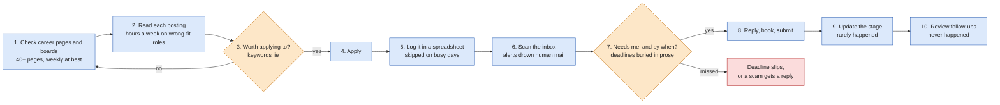
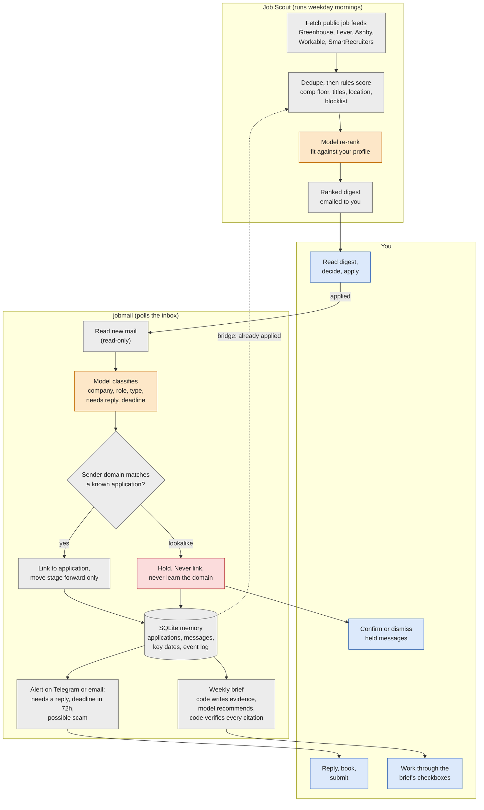

# Process map

Two maps: how a job search runs today, and how it runs with Job Scout and jobmail. Orange boxes are model steps. Gray boxes are plain code. Blue boxes are you.

## Before: the manual search

Ten steps, and only two of them need judgment (3 and 7). The rest is fetching and bookkeeping, and that is where the search falls behind.

## After: two agents, one human

Job Scout finds roles. jobmail tracks what happens after you apply. A read-only bridge lets Scout skip roles you already applied to. The model makes two judgment calls: re-rank postings, and read and classify email. It also drafts the weekly brief's recommendations, and code verifies every citation. Everything else is code that tests can pin down.

### Where a human decides

| Point | What the human does |
|---|---|
| Profile setup | Reads and approves the drafted profile before the first scan |
| Digest | Decides which roles to apply to. Scout never applies for you |
| Reply or deadline alert | Writes the reply. jobmail never replies, drafts, or deletes |
| Held message | Confirms or dismisses a possible scam. Held mail is never acted on |
| Classifier failure | A failed model call lands on the "needs a human look" list at high urgency, not filed as handled |
| Weekly brief | Acts on, or ignores, each recommendation. Code checks that every one cites real evidence |

### Where the model sits, and where it doesn't

| Step | Model or code | Why |
|---|---|---|
| Rank a posting against your profile | Model, after code rules | Scope and level live in the prose, and keywords lie |
| Read and classify an email | Model | Free text in, typed record out |
| Link mail to an application | Code | Thread headers, then company, then sender domain. Explainable and testable |
| Move a stage | Code | A forward-only state machine. A model should not decide an offer un-happens |
| Catch a lookalike sender | Code, reading memory | The model passed the lookalike as genuine in 6 of 6 eval runs. Only the history shows the tell |
| Write the brief's recommendations | Model, then code | Each one must cite an evidence id that code verifies |
